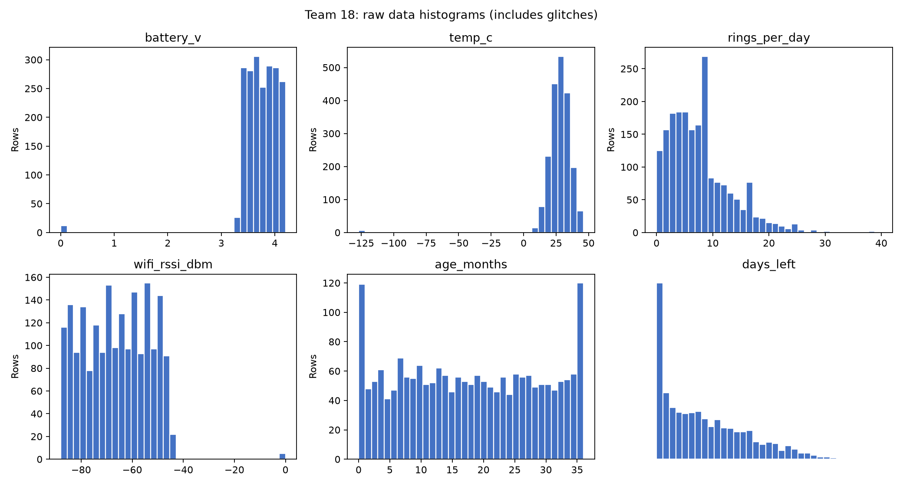
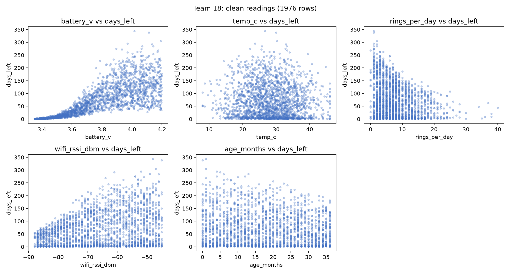
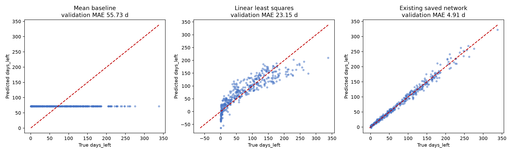
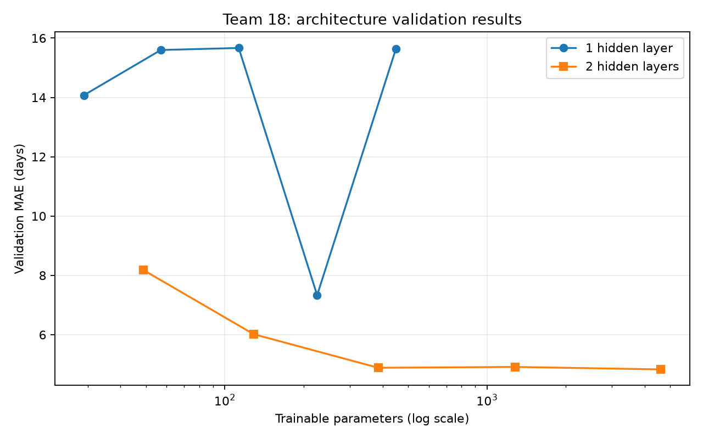
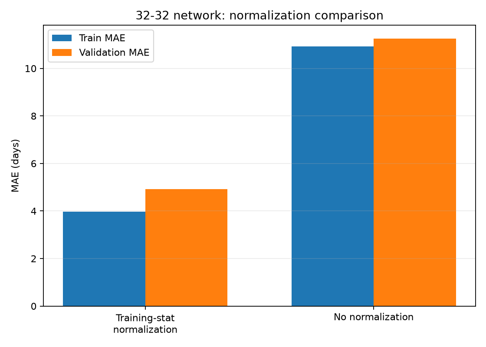

# Module 1: How Long Will the Battery Last?

**AI255TBD Edge AI · Module 1 assignment: Neural Networks from Scratch to Deployment**
Team of four · runs entirely in GitHub Codespaces (no board this time)

The doorbell company wants a number instead of "Low": **how many days of battery are left?**
You train a small neural network on your team's log and serve it as a live API from a GitHub
Codespace. The API also reports where its time goes, and whether the model would fit inside
the doorbell itself.

**You hand in one thing: a working endpoint.** Your instructor checks it with a script that
sends it readings. There is no report and no viva, so the endpoint has to speak for you.

This README is everything you need: what to do, in what order, and what is checked.
**Find your team number in `TEAMS.csv`.** Your data file is `data/team_NN_train.csv` with that
number. Use only your own team's file: every team's data, and the right answer, is different.

---

## 1. What is in this repository

| Path | What it is | Your job |
|---|---|---|
| `TEAMS.csv` | Team numbers and names | Find your number |
| `data/` | Every team's `team_NN_train.csv` | Use only yours |
| `train.py` | Filters impossible readings, reports mean/linear baselines, normalises from training rows, trains and saves the network | Run with the selected team and architecture |
| `app/model.py` | The network (5 → 32 → 32 → 1, ReLU), shared by training and the server | Change the layer sizes if you choose to |
| `app/main.py` | Range-validated API: `GET /health`, `GET /model_info`, `POST /predict`, `POST /predict_batch` | Keeps request/response names and shapes stable |
| `client/bench.py` | Times your API from outside: first request, p50/p95/p99 per stage | Run it, don't change it |
| `client/compare_batch.py` | Compares individual predictions with one batch request | Run against the API |
| `analyze_assignment.py` | Reproduces team 18 data, baseline, architecture, and memory analyses without saving a model | Run from this folder |
| `results/` | Generated plots, experiment CSVs, and local benchmark outputs | Keep results with the assignment |
| `.devcontainer/` | Makes Codespaces install everything on start | Leave it alone |
| `model/` | Created by `train.py`: `model.pt` and `config.json` | **Commit it** |

---

## 2. Set up (about 20 minutes)

1. One member creates a new repository on GitHub for your team and uploads **everything** in
   this folder, keeping the folders as they are. Include the hidden `.devcontainer` folder
   (on a Mac press Cmd+Shift+. in Finder to see it). Add the other three as collaborators.
2. On your repository: **Code → Codespaces → Create codespace on main**. The first start
   installs PyTorch and takes a few minutes. If nothing installs by itself, run
   `pip install -r requirements.txt` in the terminal.
3. Check that `data/team_NN_train.csv` (your number) is there.
4. In the Codespace terminal, from the top folder:
   ```
   python train.py --team NN
   uvicorn app.main:app --host 0.0.0.0 --port 8000
   ```
   The starter runs before you fill in any TODO. Its error will just be large.
5. **Ports** tab → right-click **8000** → **Port Visibility → Public**. Copy the address
   (`https://<name>-8000.app.github.dev`).
6. On your laptop, open `<address>/health`, then `<address>/docs` to try `/predict` by hand.
7. On your laptop: `pip install requests numpy`, then
   `python client/bench.py --url <address> --n 20`.

Stop the Codespace when you are not using it (your free hours are limited). Commit and push
after every mission.

**Every time the Codespace restarts, port 8000 goes back to Private.** After a restart, run
`uvicorn` again and set the port to **Public** again, or nobody else can reach your endpoint.

**Before Mission 3:** ask an LLM which stage of a web request will be the slowest. Log its answer.

---

## 3. What you need to do

Every mission follows the same loop: **write a prediction with a number → measure → explain the
gap.** Rotate the roles (Builder, Measurer, Skeptic, Scribe) so everyone builds every part.

### Mission 1: Meet the data and set the bar
- [ ] Predict the error of always guessing the average.
- [x] Plot a histogram of every column, and `days_left` against each input. Which relationships are not straight lines?
- [x] **Code (`train.py`):** write the glitch rule for each kind of impossible reading you find, and count the rows removed.
- [x] Report the validation MAE (in days) of **baseline 1**, always predicting the mean.
- [x] **Code (`train.py`):** report the validation MAE of **baseline 2**, linear regression with `np.linalg.lstsq`. Plot predicted against true. Where is it most wrong?
- [ ] Run `train.py` as it is and record the network's MAE.

### Mission 2: A small network, opened up
- [x] Predict, by hand, the parameters, float32 bytes and MACs of 5 → 32 → 32 → 1.
- [x] **Code (`train.py`):** normalise the inputs using the training rows only. Compare training with and without normalisation.
- [x] Train with hidden widths 4, 8, 16, 32 and 64, with one and two hidden layers (`--hidden 16` or `--hidden 32,32`). Plot validation MAE against parameters.
- [x] Compare training MAE with validation MAE for your chosen size. Is it overfitting?
- [x] Work out the per-layer table (parameters, bytes, MACs) by hand, then **code (`app/main.py`):** make `/model_info` compute it from the network itself.
- [x] Choose your final model and write down the MAE you expect on the company's 400 unseen readings.

### Mission 3: Serve it, and time every stage
- [ ] Predict the inference time and the laptop-to-Codespace round trip.
- [x] **Code (`app/main.py`):** give every input a range, so glitches get HTTP 422. Base the ranges on what a real sensor can report, not on your data's smallest and largest values: a real reading just outside your data must still get an answer. Three invalid payloads were tested over HTTP; the Swagger schemas were checked through OpenAPI.
- [x] **Code (`app/main.py`):** time `normalise`, `inference` and `build` the same way `parse` is timed.
- [ ] From your **laptop**: `python client/bench.py --url <address> --n 200`. Record the first request, then p50/p95/p99 of the round trip and every stage.
- [ ] Draw where the time goes in a typical request (server stages + network and framework). Was the LLM right?
- [x] Run it again with `--no-keepalive`, and once inside the Codespace against `http://localhost:8000`. Explain both differences.
- [x] Time 400 single `/predict` calls against one `/predict_batch` call of 400 rows. Explain the difference.

### Mission 4: Would it fit inside the doorbell?
ESP32-S3: about 512 KB SRAM (roughly 300 KB free for your program), 8 MB PSRAM, 16 MB flash.
- [x] For your model: bytes for weights and biases as float32 and int8, and the largest activation memory needed at once.
- [x] **Code (`app/main.py`):** add `total_bytes_int8`, `fits_300kb_sram_f32` and `fits_300kb_sram_int8` to `/model_info`.
- [x] Use the same function to fill in the table for 5 → w → w → 1 at w = 32, 128, 256, 512 and 2048: parameters, float32 size, int8 size, fits in 300 KB SRAM (float32 and int8), fits in 8 MB PSRAM, MACs.
- [x] Find the exact width where the weights stop fitting in 300 KB, at float32 and at int8.
- [x] Estimate one prediction's time on the board. State the speed you assume and where it came from.
- [x] Argue: should the doorbell call your server or run the model itself? Use latency, privacy, cost, power, and what happens when the Wi-Fi is down.

---

### Team 18 measured results (22 November 2026)

The analysis used `data/team_18_train.csv` and the same physical ranges, seed-0
permutation, 80/20 split, Adam settings, batch size, and epoch count as `train.py`.
`train.py` itself was not rerun because it unconditionally overwrites the
protected model files; the saved network was evaluated read-only and the fresh
experiment weights were never written to `model/`.
There are 2,000 raw rows; 24 were outside the declared sensor ranges (12 battery
voltage, 7 temperature, 5 Wi-Fi RSSI; none for rings/day or age), leaving 1,976.
The fixed split has 1,581 training and 395 validation readings. Histograms include
the raw glitches so they are visible; feature-vs-target plots use the 1,976 clean
rows. Battery voltage has a clear curved relationship with remaining days, and
rings/day has a curved decreasing envelope; the other individual feature plots
are more scattered and are not well described by a single straight line.





| Validation model | Train MAE (days) | Validation MAE (days) |
|---|---:|---:|
| Predict training-set mean | 52.50 | 55.73 |
| NumPy least-squares linear regression | 22.08 | 23.15 |
| Existing saved 32-32 network | 3.98 | 4.91 |



The validation scatter and `results/largest_validation_errors.csv` identify the
largest misses. The saved model's largest validation miss is CSV row 623: true
177.90 days, predicted 210.97 days, absolute error 33.07 days. The linear model's
largest miss is CSV row 1649: true 338.20, predicted 209.94, an error of 128.26
days. These rows are examples from the fixed validation split, not extra test data.
No numerical guess for the mean baseline was recorded before measuring it, so this
README reports the measured 55.73-day validation MAE rather than presenting a
retrospective guess as a prediction.

For normalization and architecture experiments, each model was freshly trained
for 1,500 epochs with seed 0. Normalization uses only the training partition's
mean and standard deviation. The two 32-32 runs differ only by whether that
normalization is applied:

| 32-32 network inputs | Train MAE (days) | Validation MAE (days) |
|---|---:|---:|
| Training-set normalization | 3.98 | 4.91 |
| No normalization | 10.92 | 11.25 |

| Hidden layers | Parameters | Train MAE (days) | Validation MAE (days) |
|---|---:|---:|---:|
| 4 | 29 | 13.33 | 14.07 |
| 8 | 57 | 15.20 | 15.60 |
| 16 | 113 | 15.15 | 15.67 |
| 32 | 225 | 7.49 | 7.33 |
| 64 | 449 | 15.15 | 15.63 |
| 4-4 | 49 | 7.90 | 8.18 |
| 8-8 | 129 | 5.55 | 6.02 |
| 16-16 | 385 | 4.49 | 4.88 |
| 32-32 (currently deployed) | 1,281 | 3.98 | 4.91 |
| 64-64 | 4,609 | 3.43 | 4.83 |





The current model's validation MAE is 0.94 days above its training MAE, indicating
some generalization gap. The 64-64 experiment has a larger 1.40-day gap. Although
64-64's validation MAE is 0.08 days lower, that small difference on one 395-row
holdout does not justify replacing the already deployed model; its parameter count
is over 3.5 times larger. The current model is therefore preserved. Based on its
4.91-day validation MAE, about 4.9 days is the estimate for MAE on 400 unseen
readings; it is an estimate, not a result on the company's hidden set.

#### Mission 3 timing observations

These are localhost measurements from this environment, not laptop-to-public-
Codespace measurements. The existing benchmark ran 200 individual requests in
each mode; p50/p95/p99 exclude the first request:

| Local run | First round trip | Round trip p50 / p95 / p99 (ms) | Inference p50 (ms) | Server total p50 (ms) | Network/framework remainder p50 (ms) |
|---|---:|---:|---:|---:|---:|
| Keep-alive | 7.3 ms | 2.573 / 3.976 / 4.445 | 0.136 | 0.186 | 2.363 |
| No keep-alive | 3.7 ms | 3.064 / 4.192 / 5.524 | 0.135 | 0.188 | 2.883 |

An earlier 200-request CSV is also available at
[bench_20261122_164024.csv](bench_20261122_164024.csv). Its first round trip was
3.693 ms; excluding that first request, its round-trip p50/p95/p99 were
3.040/5.394/6.977 ms. The CSV has no URL, host, or connection-mode metadata, so
these measured values are included but cannot be verified as a public
laptop-to-Codespace run:

| Earlier CSV stage | p50 (ms) | p95 (ms) | p99 (ms) |
|---|---:|---:|---:|
| Round trip | 3.040 | 5.394 | 6.977 |
| Parse (FastAPI pre-handler) | 0.000 | 0.000 | 0.000 |
| Normalise | 0.023 | 0.031 | 0.054 |
| Inference | 0.136 | 0.184 | 0.353 |
| Build | 0.017 | 0.021 | 0.045 |
| Server total | 0.188 | 0.247 | 1.503 |
| Network/framework remainder | 2.841 | 5.208 | 6.792 |

For the 400-reading comparison, 400 individual `/predict` calls took 1,502.244
ms total (116.452 ms summed server time); one `/predict_batch` call took 8.356 ms
(1.424 ms server time), a 179.78x elapsed-time speedup in this run. Both returned
the same 400 rounded predictions (maximum and mean absolute difference: 0 days).
Summed single-request stage timings were 11.315 ms normalisation, 85.649 ms
inference, 13.187 ms response building, and 0 ms reported parsing; the one batch
reported 0.639 ms, 0.413 ms, 0.360 ms, and 0 ms for those stages, respectively.
The single-call client/framework remainder was 1,385.792 ms, versus 6.932 ms for
the batch call. These are elapsed timings from one local run, not averages over
multiple 400-row trials.
The repeated per-request HTTP, JSON, validation, and response handling dominate
the 400-call run; batching amortizes that framework overhead and runs inference
over an array. The reported `parse` field remains `0.0` because FastAPI parses and
validates the body before the prediction function starts. Thus the client-side
remainder includes framework work as well as local transport; it is not pure
network time. The local timing is not a measurement of remote Wi-Fi latency.

To collect the required laptop-to-Codespace measurements once the public URL is
available, run from this folder:

```sh
python client/bench.py --url https://<your-codespace>-8000.app.github.dev --n 200
python client/bench.py --url https://<your-codespace>-8000.app.github.dev --n 200 --no-keepalive
```

Replace the placeholder with the actual Codespace URL. The available earlier CSV
is reported above, but its destination cannot be identified; run these commands
to capture a verifiable public-endpoint result. A pre-run prediction of the
slowest stage was not recorded before these measurements, so the timings above
are observations, not a retroactive prediction.

#### Mission 4 storage and device estimate

For `5 → w → w → 1`, including biases, parameters are `w² + 8w + 1` and MACs
per prediction are `w² + 6w`. The activation column is a conservative batch-1
estimate of two FP32 hidden-width working buffers (`2 × w × 4` bytes). SRAM
combined-fit columns include this estimate; PSRAM columns show model weights
only. INT8 byte counts count one byte per parameter, including biases, and omit
quantization scales/metadata.

| Width | Parameters | FP32 weights (B) | INT8 weights (B) | MACs | Activation estimate (B) | 300 KiB SRAM: FP32 weights + activation | 300 KiB SRAM: INT8 weights + FP32 activation | 8 MiB PSRAM: FP32 / INT8 weights |
|---:|---:|---:|---:|---:|---:|---|---|---|
| 32 | 1,281 | 5,124 | 1,281 | 1,216 | 256 | Fits | Fits | Fits / Fits |
| 128 | 17,409 | 69,636 | 17,409 | 17,152 | 1,024 | Fits | Fits | Fits / Fits |
| 256 | 67,585 | 270,340 | 67,585 | 67,072 | 2,048 | Fits | Fits | Fits / Fits |
| 512 | 266,241 | 1,064,964 | 266,241 | 265,216 | 4,096 | Does not fit | Fits | Fits / Fits |
| 2048 | 4,210,689 | 16,842,756 | 4,210,689 | 4,206,592 | 16,384 | Does not fit | Does not fit | Does not fit / Fits |

Weights alone fit within 300 KiB up to width 273 in FP32 or width 550 in INT8.
Including the conservative activation buffers, those maxima become 272 and 546.
For the deployed width 32 model, FP32 weights are 5,124 bytes and the activation
estimate is 256 bytes; INT8 weights are 1,281 bytes. These are storage estimates,
not a full firmware memory map—runtime, stack, input/output buffers, and quantizer
metadata also consume memory. The table distinguishes internal SRAM from the
8 MiB PSRAM budget; at width 2048, the FP32 weights exceed PSRAM while the INT8
weights fit PSRAM but not the 300 KiB SRAM budget.

The deployed model's `/model_info` layer table is:

| Layer | In | Out | Parameters (including bias) | FP32 bytes | MACs |
|---|---:|---:|---:|---:|---:|
| linear1 | 5 | 32 | 192 | 768 | 160 |
| linear2 | 32 | 32 | 1,056 | 4,224 | 1,024 |
| linear3 | 32 | 1 | 33 | 132 | 32 |
| **Total** | | | **1,281** | **5,124** | **1,216** |

The selected model performs 1,216 MACs. Espressif specifies a maximum 240 MHz
ESP32-S3 CPU clock ([product specification](https://www.espressif.com/en/products/socs/esp32-s3)).
At an idealized one MAC per clock, the arithmetic-only lower bound is
`1,216 / 240,000,000 = 5.07 μs`. This is a calculation, not measured board
latency; memory traffic, normalization, activation, quantization, and runtime
overhead make a real implementation slower.

For this small model, on-device inference could respond without a network round
trip, keep readings local, and continue during Wi-Fi outages. It also avoids
per-request server/network costs, although firmware deployment, quantization,
and device-side updates have their own engineering and maintenance costs. A
server can use a larger model and is easier to update centrally, but sends
readings over the network, adds latency, needs connectivity, and incurs hosting
and data-transfer costs. A practical design is local inference for immediate
operation with optional server sync for updates or analytics; the choice should
also account for the doorbell's energy budget and secure data handling.

Reproduce the offline analysis and local batch comparison from this folder with:

```sh
python analyze_assignment.py
python client/compare_batch.py --url http://127.0.0.1:8000 --n 400
```

The analysis script reads the existing model but never writes `model/model.pt` or
`model/config.json`. It intentionally replaces files it generates under
`results/` when rerun.

The five generated plots embedded above are `column_histograms.png`,
`features_vs_days_left.png`, `validation_predicted_vs_true.png`,
`validation_mae_vs_parameters.png`, and `normalization_comparison.png`. The
eleven CSVs in `results/` are:

| CSV | Contents |
|---|---|
| [architecture_experiments.csv](results/architecture_experiments.csv) | Ten hidden-width/depth experiments |
| [batch_comparison_requests.csv](results/batch_comparison_requests.csv) | Timings and answers for each single request plus the batch |
| [batch_comparison_summary.csv](results/batch_comparison_summary.csv) | Elapsed times, server totals, speedup, and prediction differences |
| [bench_20261122_170713.csv](results/bench_20261122_170713.csv) | 200-request localhost keep-alive timing run |
| [bench_20261122_170718.csv](results/bench_20261122_170718.csv) | 200-request localhost no-keep-alive timing run |
| [glitch_counts.csv](results/glitch_counts.csv) | Out-of-range row counts |
| [largest_validation_errors.csv](results/largest_validation_errors.csv) | Top ten error examples for each validation predictor |
| [mission1_baselines_and_saved_model.csv](results/mission1_baselines_and_saved_model.csv) | Baseline and existing-network train/validation MAEs |
| [mission4_calculations.csv](results/mission4_calculations.csv) | SRAM/PSRAM limits and ESP32-S3 timing assumptions |
| [mission4_memory_table.csv](results/mission4_memory_table.csv) | Width, parameter, weight, activation, MAC, and fit table |
| [normalization_comparison.csv](results/normalization_comparison.csv) | Normalized versus unnormalized 32-32 training |

## 4. What to hand in, and how it is checked

**Last date of submission: Monday, 23 November 2026.** How to submit will be announced. You will need:
1. **Your endpoint address**, e.g. `https://<name>-8000.app.github.dev`
2. **Your repository link**, with every TODO done and the `model/` folder committed

**Keep the endpoint running during the check window** your instructor announces: Codespace
started, `uvicorn` running, port 8000 set to **Public** (check it again after any restart). A Codespace stops itself when idle, so
in GitHub **Settings → Codespaces → Default idle timeout**, set it as long as it goes before
the window, and keep the Codespace open in a browser tab while the window is on. If the script
cannot reach your endpoint, it cannot give you marks.

The script checks:

| Check | What it does | To pass |
|---|---|---|
| Health | `GET /health` | `"status": "ok"` and **your** team number |
| Accuracy | Sends the company's 400 hidden readings to `/predict` one at a time | Error (MAE) close to what a good small network gets on your data |
| Per-layer table | `GET /model_info` | Every layer's params, bytes and MACs right; layers connect 5 → … → 1; totals, int8 bytes and both "fits" answers right; `total_params` equals `/health`'s `params` |
| Broken readings | Sends five broken readings | All five refused with a 4xx error, none answered |
| Stage timing | Reads `timings_ms` on every reply | `parse`, `normalise`, `inference`, `build` and `server_total` on every reply |
| Batch | Sends 50 readings to `/predict_batch` | Same answers as 50 single `/predict` calls |

Before you submit, test it yourself from your laptop:
```
python client/bench.py --url <your address> --n 50
```
and open `<your address>/health` and `<your address>/model_info` in a browser.

You don't hand in the missions. They are how you get to a good endpoint, and every number
the script checks comes out of them.

## 5. Quick reference

**The API (do not change the names or shapes):**
```
GET  /health          -> {"status": "ok", "team": 7, "params": 1281, "val_mae": 3.9}
GET  /model_info      -> {"layers": [{"name": "linear1", "in": 5, "out": 32, "params": 192,
                                      "bytes_f32": 768, "macs": 160}, ...],
                          "total_params": 1281, "total_bytes_f32": 5124, "total_bytes_int8": 1281,
                          "total_macs": 1216, "fits_300kb_sram_f32": true, "fits_300kb_sram_int8": true}
POST /predict         {"battery_v": 3.86, "temp_c": 28.0, "rings_per_day": 5,
                       "wifi_rssi_dbm": -66, "age_months": 22}
                      -> {"days_left": 97.4, "timings_ms": {"parse": .., "normalise": ..,
                          "inference": .., "build": .., "server_total": ..}}
POST /predict_batch   {"rows": [reading, ...]} -> {"days_left": [...], "timings_ms": {...}}
broken reading        -> HTTP 422 with the reason
```

FastAPI parses and validates the request body before the prediction function runs. For
compatibility, `parse` is reported as `0.0` ms, and `server_total` measures only the work
after validation; client round-trip time still includes request parsing.

**Columns:** `battery_v` (V), `temp_c` (°C), `rings_per_day`, `wifi_rssi_dbm` (dBm, closer to 0 is stronger), `age_months`, `days_left` (the answer).

**Useful commands**
```
python train.py --team NN --hidden 32,32 --epochs 1500
uvicorn app.main:app --host 0.0.0.0 --port 8000
python client/bench.py --url <address> --n 200 [--no-keepalive]
```

**Counting a `Linear(a, b)` layer:** a×b weights + b biases; a×b MACs per prediction; float32 = 4 bytes, int8 = 1 byte.

---

## 6. Rules for using an LLM

- Use it to explain, to check your reasoning, to explain error messages, and for hints. Do not use it for finished code.
- Your measurements are the judge. If an LLM makes a claim you can test, test it.
- Everyone must be able to explain every line you submit.
- Everyone in the team should understand how each part of the endpoint works.

## 7. When things go wrong

| Problem | Try |
|---|---|
| The Codespace is still installing | The first start installs PyTorch. Wait; don't rebuild |
| `No module named torch` (or fastapi) | The `.devcontainer` folder was not uploaded. Run `pip install -r requirements.txt` |
| `/health` works in the Codespace but not from your laptop | Port 8000 is still Private. Set it to Public |
| The address stopped working | The Codespace went idle. Start it, rerun `uvicorn`, and set port 8000 to Public again |
| `ModuleNotFoundError: app` | Run commands from the top folder, not from inside `app/` |
| `model/config.json` not found | Run `train.py` first, and commit `model/` |
| `/model_info` is wrong after changing the layer sizes | Compute it from `net.net`, not by hand |
| A result looks impossible | Good: that is the Skeptic's job. Find another explanation and test it |

Still stuck? Ask a teammate, then an LLM (and check what it says), then your instructor.

*Predict honestly. Measure carefully. Explain everything.*
